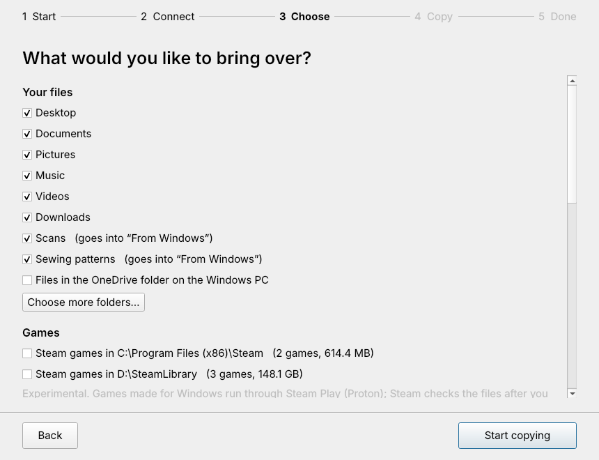
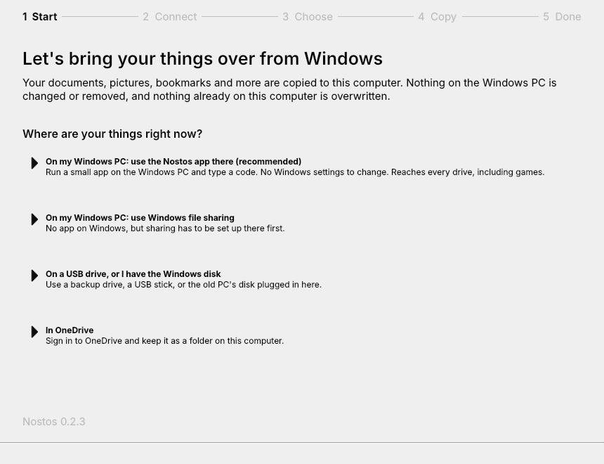
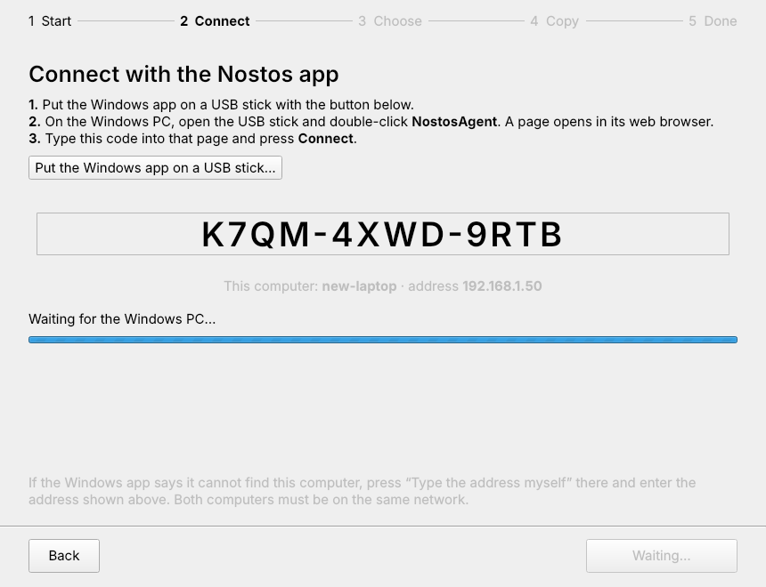
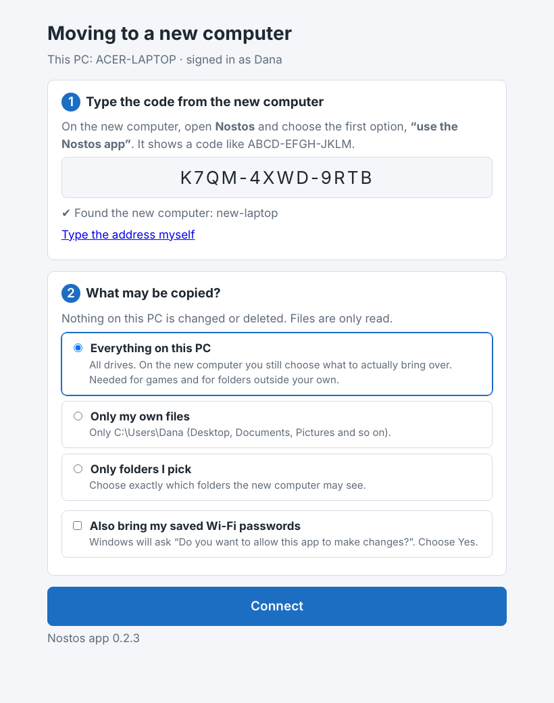
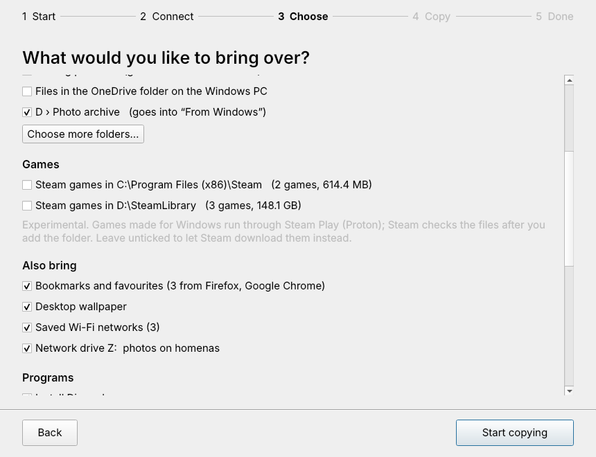
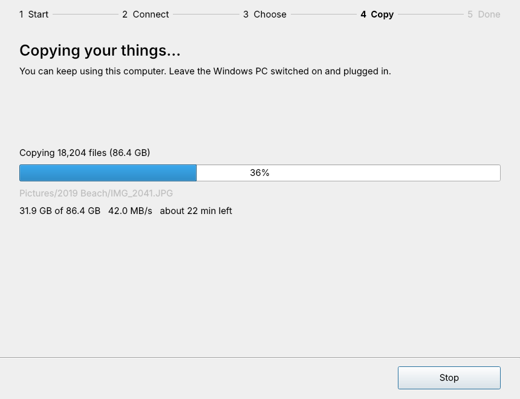
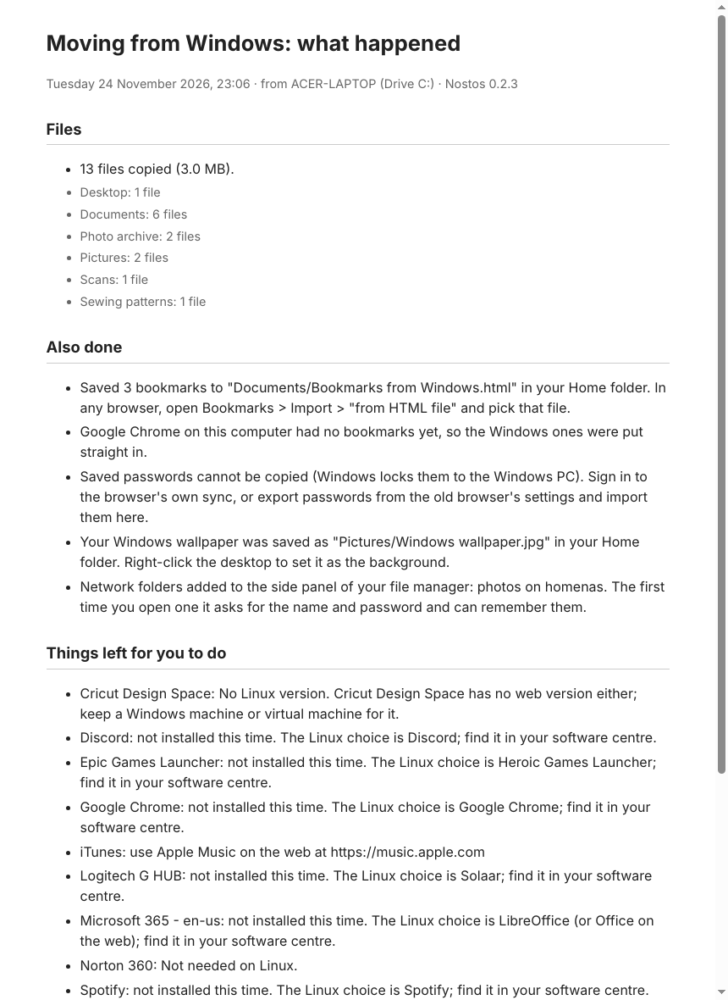

# Nostos 0.2.3

[](https://github.com/builtbyfood/nostos/actions/workflows/ci.yml)

Move a person from a Windows PC to Linux with a step-by-step window.
*Nostos* is Greek for "homecoming".



**Documentation:** [User guide](docs/USER-GUIDE.md) (step by step, with screenshots) · [Troubleshooting](docs/TROUBLESHOOTING.md) · [Reference](docs/REFERENCE.md)

## How it works

1. On the Linux computer, open **Nostos** and pick where the Windows things are.
2. For a working Windows PC, put the small **Nostos app** on a USB stick (one button), run it on Windows and type the code Nostos shows.
3. Tick what to bring over. Press **Start copying**.
4. Read the short report: what was done, and what is left for a person to do.

The Windows side is only ever read. Nothing on the Linux side is overwritten: a different file with the same name is kept, and the Windows one lands beside it as `name (from Windows).ext`. Stopping and running again carries on where it left off.

## Ways to bring things in

| Source | Needs on Windows | Reaches |
|---|---|---|
| **Nostos app on Windows** (recommended) | Double-click `NostosAgent.exe`, type a code | Whatever the user allows: everything, only their files, or picked folders. All drives. |
| Windows file sharing (SMB) | A share and a password (the `Prepare this PC` helper sets up a temporary one) | One share per run |
| USB drive, backup, or the Windows disk | Nothing | That drive or folder |
| OneDrive | Nothing | The OneDrive account |

## What comes over

- **Files**: Desktop, Documents, Pictures, Music, Videos, Downloads into the matching Linux folders, including ones OneDrive "backup" moved under `OneDrive\`. Other profile folders, and any folder picked with **Choose more folders…**, go into `~/From Windows/`.
- **Bookmarks** from Chrome, Edge, Brave and Firefox, as `Documents/Bookmarks from Windows.html`. If the same Chromium browser is installed here with no bookmarks yet, they are put straight in.
- **Wallpaper** (KDE, GNOME, Cinnamon, MATE).
- **Wi-Fi networks** with passwords, into NetworkManager (Nostos app with the Wi-Fi box ticked, or the SMB helper).
- **Mapped network drives**, into the file manager's side panel (Dolphin, and GTK file managers).
- **Programs**: a table of 86 entries recognises well over 100 Windows program names and matched to a Flatpak, a built-in program, a website, or an honest "no Linux version". Programs the table does not know are searched on Flathub and offered, unticked, as possible matches. Everything else is listed in the report with a next step. Add entries in `nostos/appmap.py`.
- **Steam games** (experimental): libraries are found from Steam's own list, shown with game count and size, and copied to `~/SteamLibrary-Windows`. Add that folder in Steam under Settings > Storage and enable Steam Play; Steam then verifies instead of downloading.
- **OneDrive**: browser sign-in, an `~/OneDrive` folder that reconnects at login, optional full download.

Not copied, by design: saved browser passwords (Windows locks them to that PC; use browser sync or the browser's export), mail (stays on the server), program settings and `AppData`.

## Install

```bash
git clone https://github.com/builtbyfood/nostos.git
cd nostos
./install.sh --dry-run
./install.sh
```

Or download the repository as a zip from GitHub, unpack it, and run `./install.sh` from inside it. To update later: `git pull`, then `./install.sh` again.

`install.sh` knows the package names for Fedora, Debian/Ubuntu/Mint, Arch and openSUSE. Where a Python part is not packaged it builds a private environment in `/opt/nostos/venv`. Remove with `./install.sh --remove`.

If the Linux computer runs a firewall that blocks incoming connections, the Nostos app on Windows needs TCP 47801 and UDP 47800 open on the Linux side. Fedora Workstation and KDE allow these by default.

Run without installing: `python3 -m nostos` (needs PySide6, smbprotocol, cryptography).

## The Nostos app for Windows

Source is in `agent/` (Go, standard library only). `./build-agent.sh` cross-compiles `nostos/windows_helper/NostosAgent.exe` from Linux.

- It opens a page in the PC's own browser, served only to that PC. Type the code, choose what may be copied, press Connect.
- It connects **out** to Nostos, so Windows needs no sharing, no firewall rule, no account and no registry change. It finds Nostos on the network by itself; the address can be typed instead.
- The link is encrypted, and both sides prove they know the code. There is no write or delete in the protocol.
- It keeps the PC awake while connected and changes nothing.
- The `.exe` is not code-signed, so Windows shows "Windows protected your PC" the first time: choose **More info > Run anyway**.

Without a window, for testing or scripting:

```
NostosAgent.exe -no-ui -connect 192.168.1.50 -code ABCD-EFGH-JKLM -mode everything
NostosAgent.exe -no-ui -connect 192.168.1.50 -code ABCD-EFGH-JKLM -share "Photos=D:\Photos"
NostosAgent.exe -find
```

## Windows file sharing instead

`Prepare this PC.cmd` (also copied to the USB stick) creates a temporary read-only account and share for the user's profile and removes them when Enter is pressed. Or tick "I shared a folder myself" and use any share, including `C$` when Windows allows admin shares for that account.

## Verified / unverified

| Area | Status |
|---|---|
| Copy engine: no-overwrite, resume, cancel, free-space check | **Verified** by tests |
| Windows app link: pairing, wrong code refused, path escape refused, whole move, lost connection, discovery | **Verified** by tests, with the agent built for Linux |
| Windows app's own page and API (token check, folder picker, connect, status) | **Verified** on the Linux build |
| `NostosAgent.exe` on real Windows | Opening the browser, PC name and user, pairing, and copying a profile through the link to a Fedora 45 KDE laptop: **verified** on Windows 10 (2026-11-24, copy seen in progress). Steam detection on a real PC, Wi-Fi export, keep-awake over a long run: **unverified** |
| Finding Nostos from Windows (discovery, or typed address) | Connected on a real LAN; which of the two was used is not recorded |
| SMB reads with `smbprotocol`; connecting to a real Windows 10 PC and counting a 49,290-file profile | **Verified** (test server, and a Fedora 45 KDE laptop on 2026-11-24) |
| A full copy from real Windows to the end (junctions, OneDrive cloud-only files, locked files) | **Unverified** |
| Chrome/Firefox bookmark extraction; sidebar files for KDE and GTK | **Verified** in tests for file contents |
| Steam library detection and copy | **Verified** in tests against a made-up library; **unverified** that Steam on Linux adopts the copied games |
| Flathub suggestions | **Verified** with a stand-in for `flatpak search`; **unverified** against the real command |
| Program table Flatpak ids | **Unverified** one by one; a wrong id shows up in the report as "could not be installed" |
| Window flow | **Verified** offscreen for a drive move and an app-link move; Start, Connect and Copy pages seen under Plasma on Fedora 45 |
| `install.sh` on Fedora 45 | **Verified** on a Fedora 45 KDE laptop (0.1.0 and 0.2.x) |
| `install.sh` on Debian/Ubuntu, Arch, openSUSE; GNOME/Cinnamon/MATE wallpaper | **Unverified** |
| `Prepare-Windows.ps1` | Reported to run successfully on Windows 10 (2026-11-24); its clean-up step is **unverified** |
| CI workflow | Test and window-test steps passed on GitHub (2026-11-24); the build step is fixed but **not yet seen passing** |
| OneDrive (rclone), Wi-Fi import, Flatpak installs, `packaging/nostos.spec` | **Unverified** |

## Roadmap

- Code-sign the Windows app.
- Other game launchers' libraries (Epic, GOG); Proton prefix hints.
- Parallel copying of small files; pause and resume from the window.
- Real two-way OneDrive sync as an alternative to the connected folder.
- rpm, deb and Flatpak packages.

## Screenshots

| Start | Connect with the app | The app on Windows |
|---|---|---|
|  |  |  |

| Choose | Copy | Report |
|---|---|---|
|  |  |  |

All screenshots use made-up data and are produced by `tools/make_screenshots.py` (offscreen, default Qt style). On Plasma the window follows the Breeze theme. The full walkthrough is in the [user guide](docs/USER-GUIDE.md).

## Tests

```bash
python3 -m pip install --user pytest impacket    # impacket only for the SMB test
python3 -m pytest tests -q                       # link tests need Go
QT_QPA_PLATFORM=offscreen python3 tests/gui_smoke.py
python3 tools/make_screenshots.py                # rebuilds docs/screenshots
```

## Layout

```
nostos/agentlink.py       waits for the Windows app; encrypted link; file access through it
nostos/fsaccess.py        read-only access: SMB share or local folder
nostos/profile.py         find Windows profiles, known folders
nostos/copier.py          count, copy, resume, never overwrite
nostos/items.py           bookmarks, wallpaper, Wi-Fi, network drives, programs, Steam
nostos/appmap.py          Windows program -> Linux replacement table
nostos/onedrive.py        rclone sign-in, ~/OneDrive service, full download
nostos/places.py          file manager sidebar entries (KDE and GTK)
nostos/discovery.py       find SMB hosts, resolve names, list shares
nostos/engine.py          runs a whole move (no GUI code)
nostos/report.py          the HTML report
nostos/gui.py             the window
nostos/windows_helper/    what goes on the USB stick: NostosAgent.exe and the SMB helper
agent/                    Go source of NostosAgent.exe
docs/                     user guide, troubleshooting, reference, screenshots
tools/make_screenshots.py regenerates every documentation screenshot
```

## Licence

Apache-2.0. See [LICENSE](LICENSE).
