# Nostos user guide

Version 0.2.3. For the person moving from a Windows PC to a Linux computer, and for whoever is helping them.

Screenshots show made-up data ("Dana" on "ACER-LAPTOP"). They were taken with the plain default look; on your computer the window follows your desktop's theme, so colours and button shapes will differ. The words are the same.

**Contents**

1. [What Nostos does](#1-what-nostos-does)
2. [Before you start](#2-before-you-start)
3. [The move, step by step](#3-the-move-step-by-step)
4. [After the move](#4-after-the-move)
5. [Other ways to bring things in](#5-other-ways-to-bring-things-in)
6. [Running it again](#6-running-it-again)
7. [What is and is not copied](#7-what-is-and-is-not-copied)
8. [Is it safe?](#8-is-it-safe)

If something goes wrong, see [TROUBLESHOOTING.md](TROUBLESHOOTING.md). Installation details, command lines and file locations are in [REFERENCE.md](REFERENCE.md).

---

## 1. What Nostos does

Nostos copies your things from a Windows PC onto a Linux computer and tells you, in plain words, what it did and what is left for you.

- Your **files** land in the matching folders: Documents in Documents, Pictures in Pictures, and so on.
- Your **bookmarks**, **wallpaper**, **Wi-Fi networks** and **network drives** come along.
- For each **program** you used on Windows it offers the Linux one to use instead, and can install it.
- It can copy your **Steam games** so they do not have to be downloaded again (experimental).
- It can connect **OneDrive** as a folder (not yet confirmed working; see [section 4](#onedrive)).

Two promises:

- **Nothing on the Windows PC is changed or deleted.** Nostos only reads from it.
- **Nothing already on the Linux computer is overwritten.** If a file with the same name is already there and is different, both are kept; the Windows one gets "(from Windows)" in its name.

## 2. Before you start

You need:

- The **Linux computer**, with Nostos installed. Look for "Nostos" in the application menu. If it is not there, see [REFERENCE.md](REFERENCE.md#installing).
- The **Windows PC**, switched on, signed in as the person whose things are moving, and plugged into power.
- **Both on the same home network.** Wi-Fi works. A network cable on both is much faster for a lot of data.
- A **USB stick** (any size) to carry a small app to the Windows PC.
- **Enough free space** on the Linux computer. Nostos checks this for you before copying and tells you if there is not enough.

Sign in to the Linux computer **as the person whose things are moving**. Nostos puts everything into the Home folder of whoever runs it.

How long it takes depends on how much there is and how fast the network is. Over Wi-Fi a large move can take many hours; a network cable is much faster. You can stop and carry on later without losing anything.

## 3. The move, step by step

The window shows where you are along the top: **Start, Connect, Choose, Copy, Done**.

### Step 1: Start

Open **Nostos** on the Linux computer.

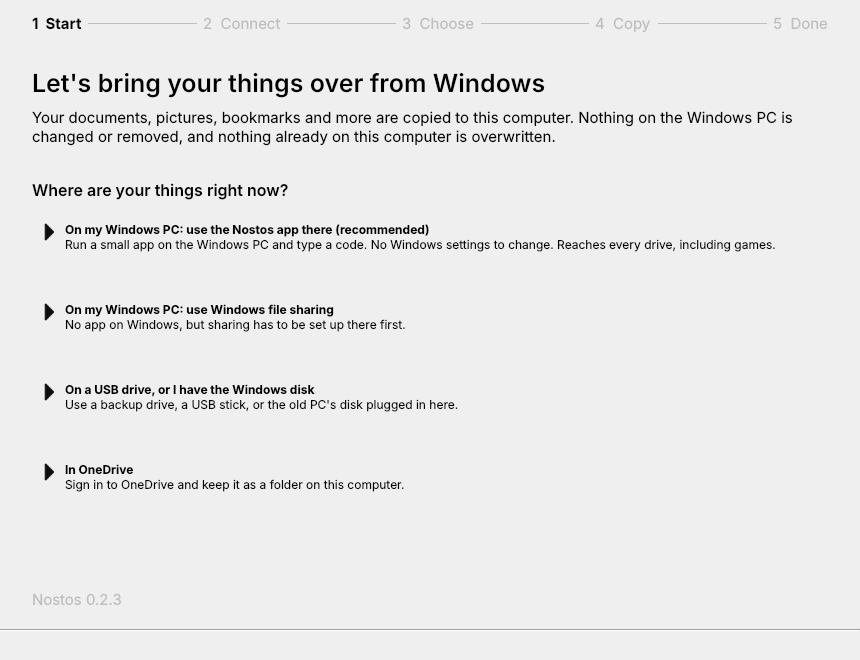

Choose the first option, **"On my Windows PC: use the Nostos app there (recommended)"**. The other options are covered in [section 5](#5-other-ways-to-bring-things-in).

### Step 2: Connect

Nostos now shows a **code** and waits.

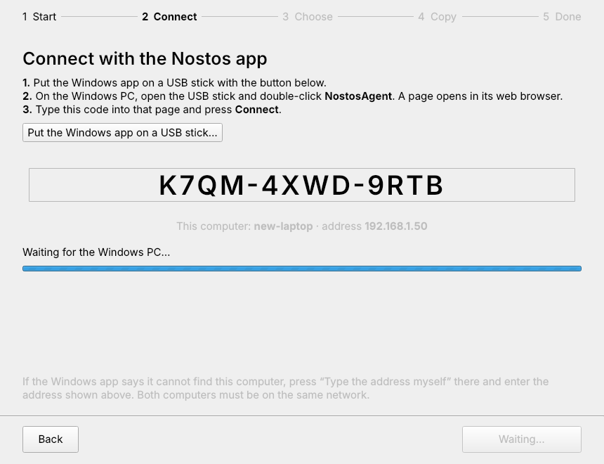

1. Plug the USB stick into the Linux computer and press **"Put the Windows app on a USB stick…"**. Pick the stick. Nostos copies a folder called **Nostos for Windows** onto it.
2. Safely remove the stick and plug it into the Windows PC.
3. On the Windows PC, open the stick, open **Nostos for Windows**, and double-click **NostosAgent**.

> **Windows may say "Windows protected your PC".** That is because the app is not registered with Microsoft. Click **More info**, then **Run anyway**.

A black window appears (leave it open) and a page opens in the web browser:

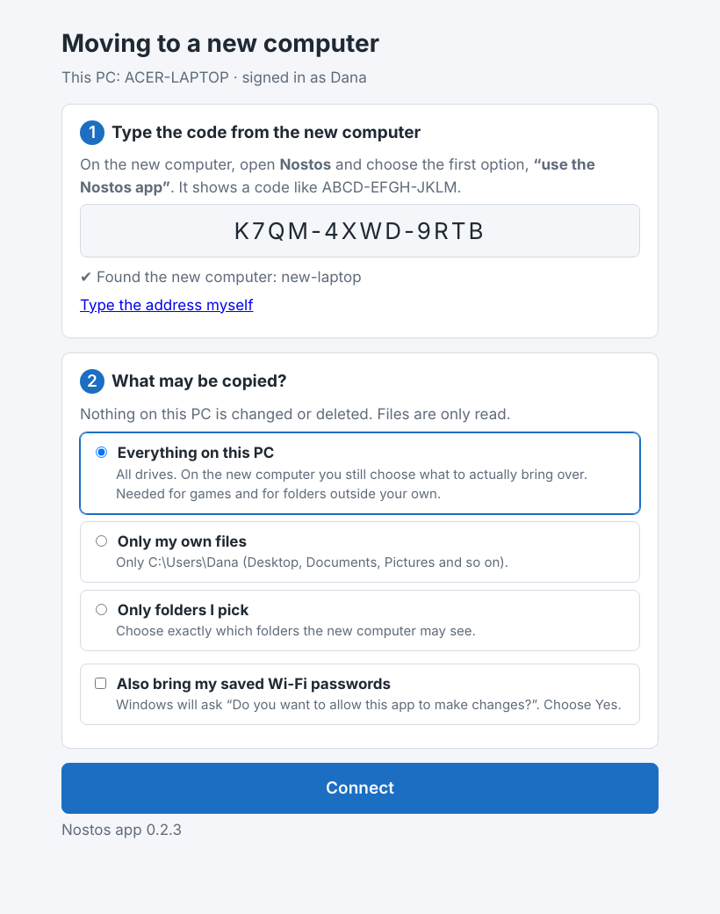

4. **Type the code** from the Linux computer into the box. Capitals and dashes are filled in for you.
5. Under the box it should say **"Found the new computer"**. If it keeps saying "Still looking", click **"Type the address myself"** and type the address shown under the code on the Linux computer (it looks like `192.168.1.50`).
6. Choose **what may be copied**:

   | Choice | Use it when |
   |---|---|
   | **Everything on this PC** | The usual choice. Needed for games and for anything outside your own folders. You still pick what to actually bring on the Linux computer. |
   | **Only my own files** | You only want your Desktop, Documents, Pictures and so on, and nothing else should even be visible. |
   | **Only folders I pick** | You want to allow exactly certain folders. Browse to each one and press **Add this folder**. |

   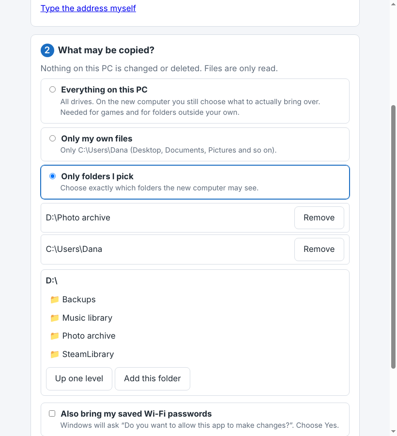

7. Tick **"Also bring my saved Wi-Fi passwords"** if you want the Linux computer to know your Wi-Fi networks. Windows will then ask "Do you want to allow this app to make changes?"; choose **Yes**.
8. Press **Connect**.

The Windows page changes to **"Connected to …"**. From here on, everything happens on the Linux computer. Leave the Windows PC switched on and plugged in; the app stops it going to sleep.

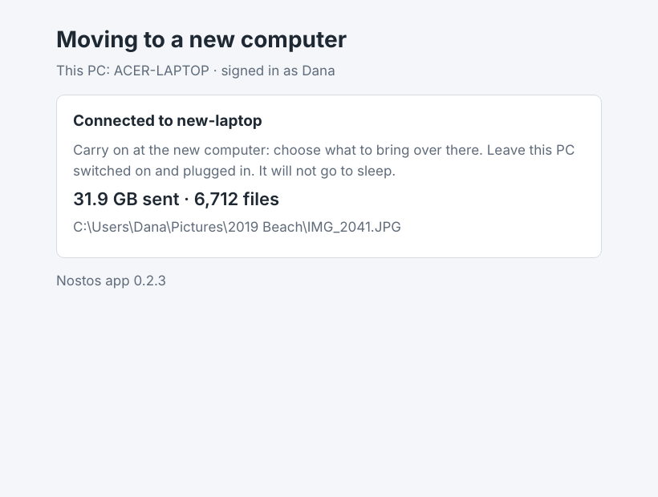

### Step 3: Choose

Back on the Linux computer, Nostos looks at the Windows PC (this can take a minute) and shows what it found. Everything sensible is already ticked. Untick anything you do not want.

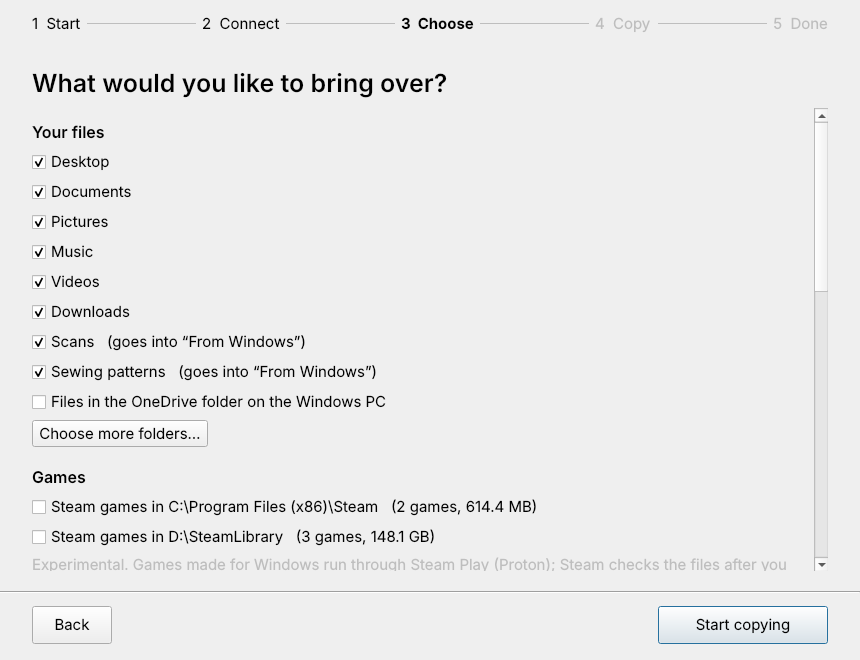

**Your files**

- **Desktop, Documents, Pictures, Music, Videos, Downloads** go into the folders of the same name.
- Other folders from your Windows user folder are listed too. They go into a folder called **From Windows** in Home.
- **"Files in the OneDrive folder on the Windows PC"** is off by default. Tick it if you are *not* going to connect OneDrive itself.
- If more than one person used the Windows PC, a **Windows user** list appears at the top. Pick whose things to bring.

**Choose more folders…** lets you add any other folder the Windows PC shares, for example on a second drive. Tick a folder to take all of it; click the small arrow to look inside.

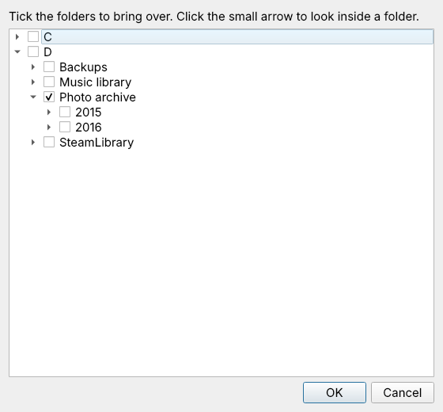

Scroll down for the rest:

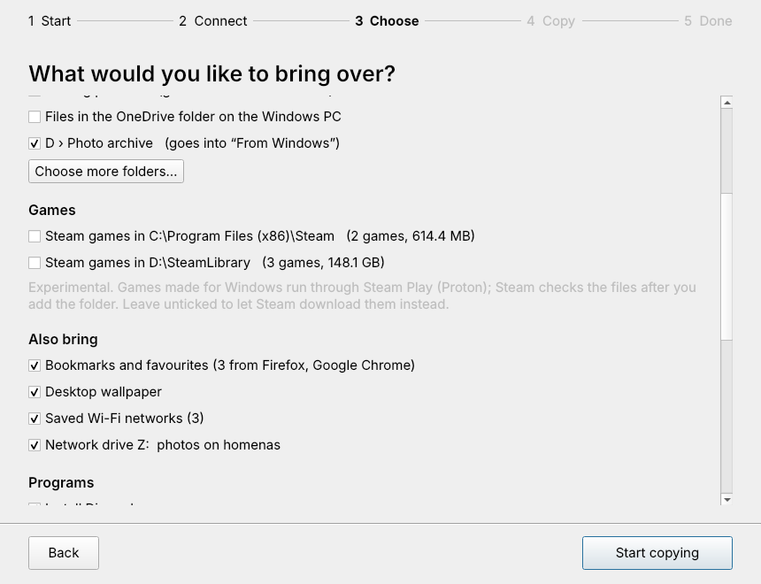

**Games** (only shown if Steam is on the Windows PC)

- Each Steam library is listed with its number of games and size. These are **off by default**, because they are large and this part is experimental. See [Steam games](#steam-games).

**Also bring**

- **Bookmarks and favourites** from Chrome, Edge, Brave and Firefox.
- **Desktop wallpaper.**
- **Saved Wi-Fi networks** (only if you ticked the Wi-Fi box on Windows).
- **Network drives** you had mapped on Windows, such as `Z:`.

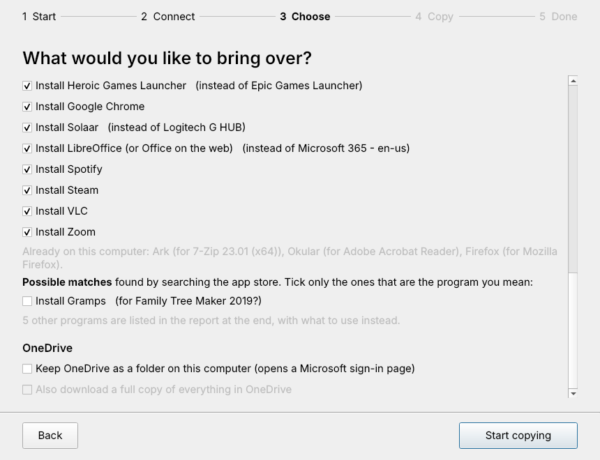

**Programs**

- **"Install …"** lines are Linux programs that replace ones you had on Windows. "(instead of …)" tells you which Windows program each replaces. Ticked ones are installed for you during the copy.
- **"Already on this computer"** lists replacements that are part of Linux already.
- **Possible matches** are guesses found by searching the app store. They are unticked. Tick one only if it really is the program you mean.
- Everything else is listed in the report at the end, with what to use instead.

**OneDrive**

- **"Keep OneDrive as a folder on this computer"** signs in to OneDrive and adds an OneDrive folder to Home. See [OneDrive](#onedrive) before using it.

When you are happy, press **Start copying**.

### Step 4: Copy

Nostos counts the files first, checks there is room, then copies.

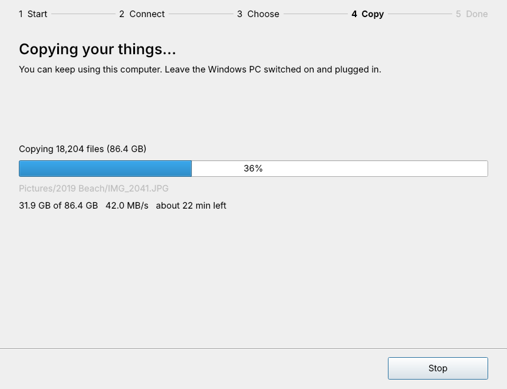

- You can keep using the Linux computer while it runs.
- The line under the bar shows how much is done, the speed, and roughly how long is left. The estimate settles after a minute or so.
- **Stop** stops after the current file. Nothing is lost; see [Running it again](#6-running-it-again).
- If it says **there is not enough room**, go back, untick something large (Videos, Pictures and games are usually the biggest) and start again.

After the files, Nostos installs the programs you ticked and does the smaller things (bookmarks, wallpaper, Wi-Fi, network drives). The status line says what it is doing.

### Step 5: Done

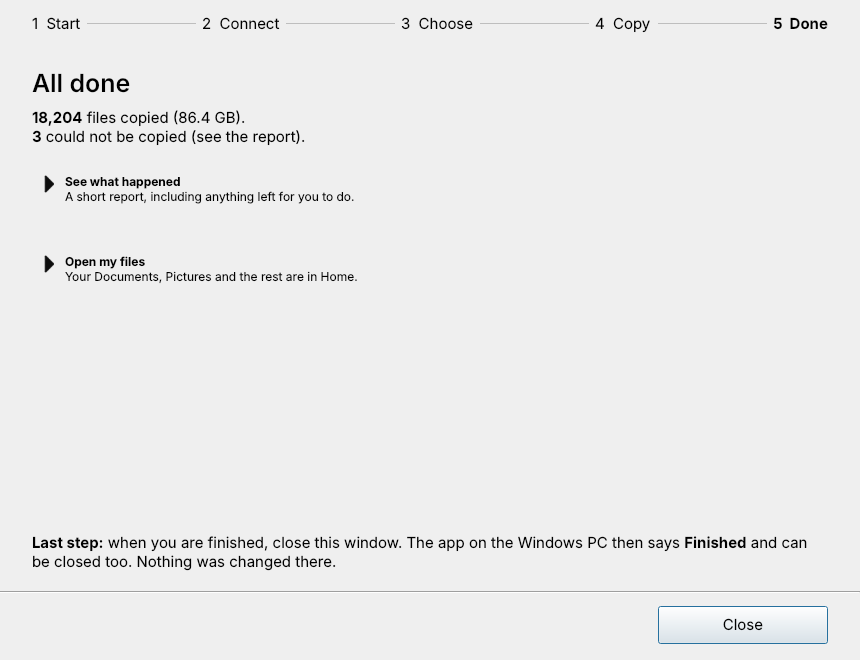

- **See what happened** opens the report.
- **Open my files** opens your Home folder.
- Press **Close** when you are finished. The page on the Windows PC then says **Finished**; press **Close Nostos on this PC** there, or just close the black window.

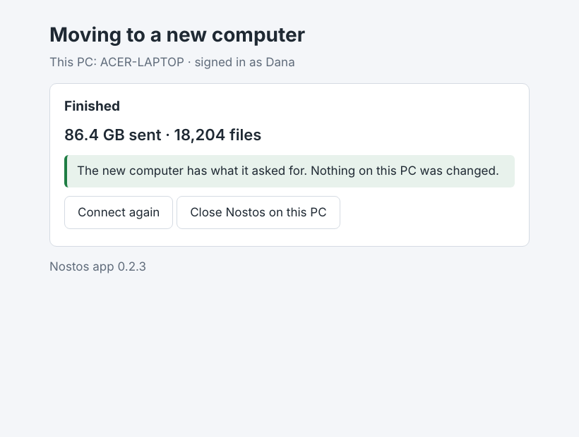

**The report** is worth reading once. It is saved as **Moving from Windows - report.html** in Documents.

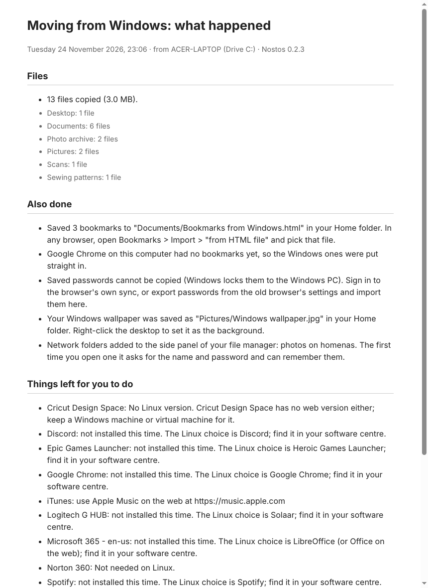

It has up to four parts:

| Part | What it tells you |
|---|---|
| **Files** | How many were copied, how many were already there, and how many had a name clash and were kept side by side. |
| **Files that could not be copied** | Each one, with the reason (see [Troubleshooting](TROUBLESHOOTING.md#files-that-could-not-be-copied)). |
| **Also done** | Bookmarks, wallpaper, Wi-Fi, network folders, programs installed. |
| **Things left for you to do** | One line per program that needs a decision, plus printers and anything else that needs a person. |

## 4. After the move

### Bookmarks and passwords

- Your bookmarks are saved as **Bookmarks from Windows.html** in Documents. In any browser, open the bookmarks menu, choose **Import**, then **from HTML file**, and pick that file.
- If the same browser (Chrome, Edge or Brave) is installed on the Linux computer and had no bookmarks yet, Nostos puts them straight in and says so in the report.
- **Saved passwords cannot be copied.** Windows locks them to the Windows PC. Either sign in to the browser's own sync (Google account in Chrome, Microsoft account in Edge, Firefox account in Firefox) on both computers, or export passwords from the old browser's settings and import them in the new one.

### Programs

- Installed programs are in the application menu.
- For each program that was not installed, the report says what to use: another program from your software centre, a website, or an honest "no Linux version".
- Program settings and saved data inside programs are not copied.

### Steam games

Experimental: the copying is tested, but whether Steam accepts the copied games has not been confirmed yet.

If you ticked a Steam library, the games are in **SteamLibrary-Windows** in Home. To use them:

1. Open **Steam** and sign in.
2. Go to **Settings > Storage**, add a folder, and pick **SteamLibrary-Windows**.
3. Go to **Settings > Compatibility** and turn on **Steam Play for all titles**.
4. Steam checks each game and downloads only what is missing.

Games that depend on Windows-only anti-cheat will not run on Linux. If Steam does not recognise the games, nothing is lost: delete the folder and let Steam download them.

### OneDrive

Not yet confirmed working against a real account. If it fails, the report says so and nothing else is affected.

If you ticked "Keep OneDrive as a folder":

- A Microsoft sign-in page opens in the browser during the copy. Sign in and allow access.
- An **OneDrive** folder appears in Home and in the side panel of the file manager. It needs the internet: files are fetched when you open them and changes are sent back.
- **"Also download a full copy"** additionally saves everything into **From Windows/OneDrive download**, which works offline.

### Network drives, Wi-Fi, printers, wallpaper

- **Network drives** are in the side panel of the file manager. The first time you open one it asks for the name and password.
- **Wi-Fi networks** are remembered; the computer joins them by itself when in range. Work or school networks that need a sign-in are listed in the report to join by hand.
- **Printers** are not set up by Nostos. Network printers usually appear by themselves in your printer settings; the report lists the ones you had.
- **Wallpaper** is set for you on KDE, GNOME, Cinnamon and MATE. On other desktops it is saved in Pictures as **Windows wallpaper**.

### When you are sure everything is there

Keep the Windows PC as it is for a while. Nostos never deletes anything from it, so it remains a complete backup until you decide otherwise.

## 5. Other ways to bring things in

### Windows file sharing (no app on Windows)

Use this when you cannot or do not want to run the app on Windows. It reaches one shared folder at a time, and programs, Wi-Fi and network drives only come across if you use the helper.

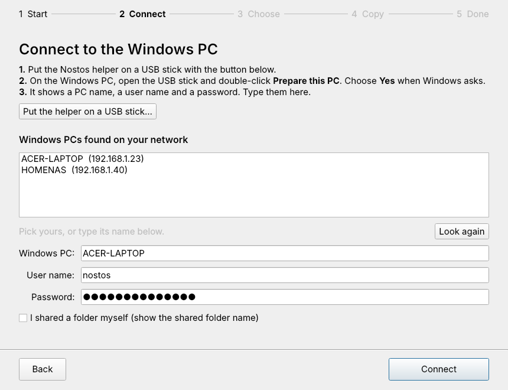

**With the helper (easiest):**

1. In Nostos, choose **"On my Windows PC: use Windows file sharing"**, then **"Put the helper on a USB stick…"**.
2. On the Windows PC, open the stick and double-click **Prepare this PC** (not the `.ps1` file next to it). Choose **Yes** when Windows asks.
3. A window shows a **PC name**, a **user name** and a **password**. Leave it open.
4. In Nostos, pick the PC in the list (or type its name), type the user name and password, and press **Connect**.
5. When the move is finished, press **Enter** in the helper window on Windows. That removes the temporary account and sharing it set up.

If the helper window was closed early, run `"Prepare this PC.cmd" -Undo` from the same folder.

**With a folder you shared yourself:**

1. Tick **"I shared a folder myself"**.
2. Type the PC, your Windows user name and password, and the name of the shared folder (for example `Users`).

Then carry on from [Step 3](#step-3-choose).

### A USB drive, a backup, or the Windows disk

Use this when the Windows PC no longer starts, or you already have a copy of the files.

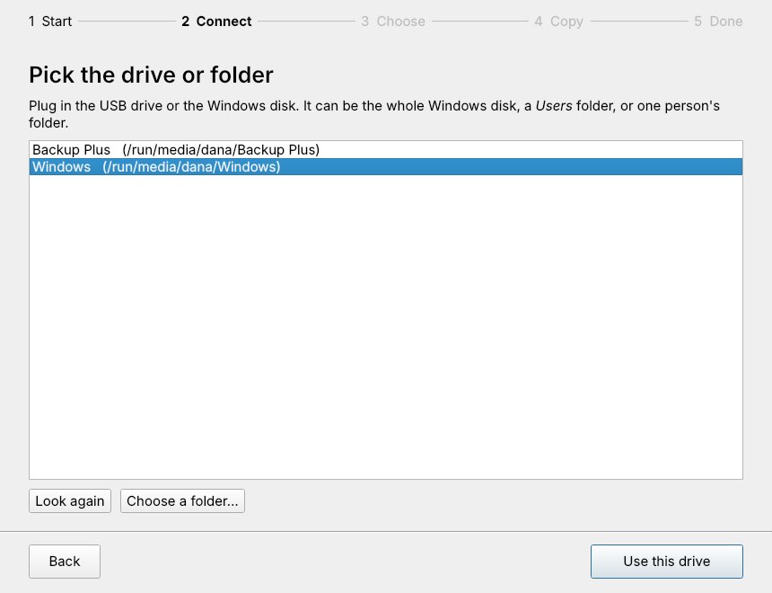

1. Plug the drive into the Linux computer and open it once in the file manager so it unlocks.
2. In Nostos, choose **"On a USB drive, or I have the Windows disk"**.
3. Pick the drive, or press **Choose a folder…**. It can be a whole Windows disk, a `Users` folder, or one person's folder.
4. Press **Use this drive** and carry on from [Step 3](#step-3-choose).

Wi-Fi networks and network drives cannot be read this way. Programs are guessed from Start menu shortcuts.

### OneDrive only

Choose **"In OneDrive"** on the Start page to connect OneDrive without copying anything from a PC. See [OneDrive](#onedrive).

## 6. Running it again

Running Nostos again is always safe.

- **After pressing Stop, or if the connection dropped:** start again the same way. Files already copied are recognised and skipped in an instant; the copy carries on from where it was.
- **To bring more later:** run it again and tick the extra things.
- **For another person on the same Windows PC:** sign in to the Linux computer as that person, run Nostos, and pick them in the **Windows user** list.
- **For another Windows PC:** just run it again with that PC.

Each time you start, Nostos shows a new code. Type the new one into the Windows app (press **Try again** or **Connect again** there).

## 7. What is and is not copied

| Copied | Where it goes |
|---|---|
| Desktop, Documents, Pictures, Music, Videos, Downloads | The folder of the same name |
| Other folders from your Windows user folder, and folders you pick | **From Windows** in Home |
| Bookmarks | **Bookmarks from Windows.html** in Documents |
| Wallpaper | Desktop background; saved in Pictures |
| Wi-Fi networks | The computer's saved networks |
| Mapped network drives | The file manager's side panel |
| Steam games (if ticked) | **SteamLibrary-Windows** in Home |

| Not copied | Why |
|---|---|
| Saved browser passwords | Windows locks them to the Windows PC |
| Email | It lives on the mail server; sign in again |
| Programs themselves | Windows programs do not run on Linux; Nostos offers replacements |
| Program settings (the hidden `AppData` folder) | They belong to the Windows programs |
| Shortcuts, `desktop.ini`, `Thumbs.db`, temporary files | Windows clutter |
| Half-finished Steam downloads | Steam redoes them |

## 8. Is it safe?

- **The Windows PC is only read.** The Nostos app has no ability to change or delete anything there.
- **You decide what is visible.** The Windows app only lets the Linux computer see what you allowed in "What may be copied?".
- **The connection is private.** It is encrypted, and it only works with the code shown on your own screen. It stays inside your home network; nothing goes to the internet (apart from OneDrive and installing programs, if you choose those).
- **Nothing is overwritten on the Linux computer.**
- **Wi-Fi passwords** are sent only if you tick the box, and travel inside the encrypted connection.
- Closing the black window on Windows stops everything at once.

More detail for the technically minded is in [SECURITY.md](../SECURITY.md).
